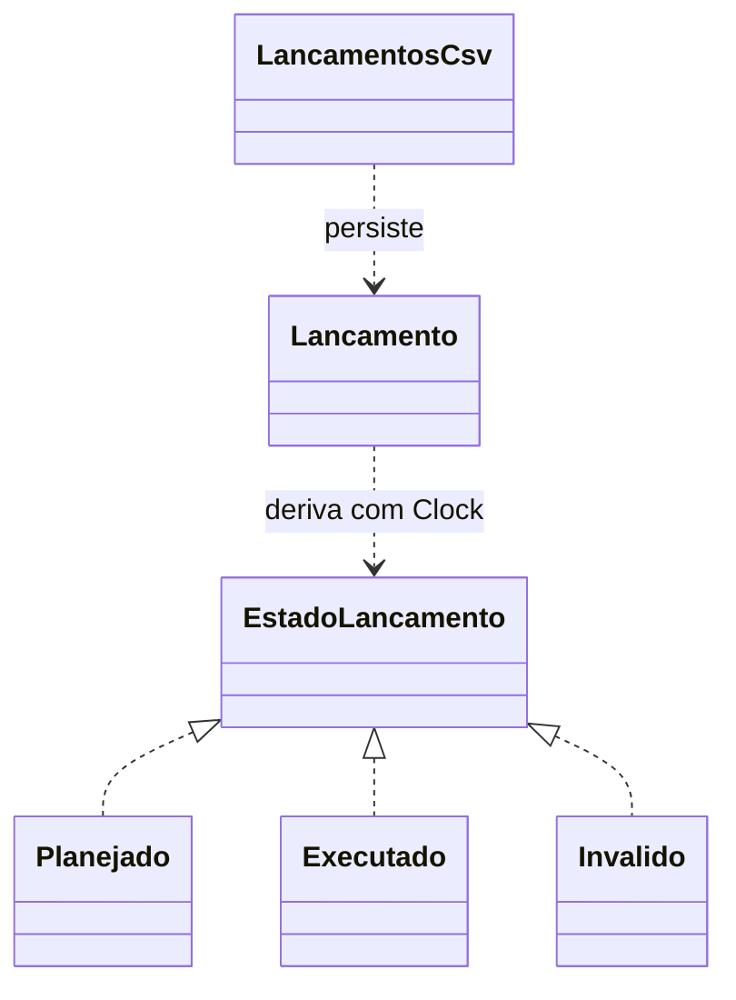

# Arquitetura e contratos

## Eventos

`Evento` tem instante imutável e método executar(Controlador). O controlador usa fila de prioridade ordenada por instante e ordem de inserção, tornando empates determinísticos. Agendar no passado, instante negativo ou voltar o relógio gera erro. O controlador avança até um limite inclusive; depois seu relógio assume o limite. Cada inserção/remoção custa O(log e), para e eventos pendentes. Um consumidor que agenda infinitamente no mesmo instante pode impedir término; o controlador genérico não impõe um orçamento artificial.

## Modelo fictício da simulação

Em cada minuto da demonstração: primeiro surto, depois consulta se for múltiplo de dez, depois evolução do intervalo até o minuto seguinte. Surto a cada 120 minutos acrescenta cinco à temperatura e reduz PAC em 60.000. O médico só medica quando temperatura >38 e PAC <50.000. Droga(2,30000) tem efeito instantâneo, limitado ao basal 37 e PAC 100.000.

No modelo, temperatura estritamente >41 por mais de 60 intervalos ou PAC <50.000 por pelo menos 30 intervalos causa óbito fictício. Retornar ao basal zera o contador correspondente. A duração máxima aceita na demonstração é 100.000 minutos. As escolhas são regras de software explicitamente novas, sem uso clínico e sem alegação de reproduzir o log antigo.

## Domínio financeiro e State

Estado derivado por `estado(Clock)`: valor negativo tem prioridade e gera Invalido; data anterior a hoje gera Executado; hoje ou futuro gera Planejado. Executado bloqueia edição. Os outros permitem edição que pode mudar o estado. A passagem de dias também pode mudar o estado, pois não se persiste um rótulo temporal potencialmente desatualizado.

`Clock` é explícito para testes determinísticos. `BigDecimal` conserva os valores decimais sem arredondamento monetário implícito. O CSV tem `id,descricao,valor,data`, aceita aspas duplicadas e campos multilinha, e rejeita estrutura malformada e IDs duplicados. Salvar exclui inválidos. A escrita usa arquivo temporário no diretório de destino e tenta move atômico; onde não há suporte, usa substituição convencional.

## Acervo e coleções

O FactorialController histórico usa long sem detectar overflow depois de 20!. MultisetHashSet usa HashSet e perde multiplicidades. São limitações do código recuperado, não corrigidas silenciosamente. O módulo novo Multiconjunto usa Map de frequências, igualdade por contagem e rejeita null.

A suíte nova compila apenas src/ e tests/. O acervo inclui GUI Swing e testes com dependências próprias; não são apresentados como aprovados pela suíte nova. Usuários, categorias e respectivos DAOs do EP2 histórico não foram reconstruídos como se seu esquema original tivesse sido encontrado.
